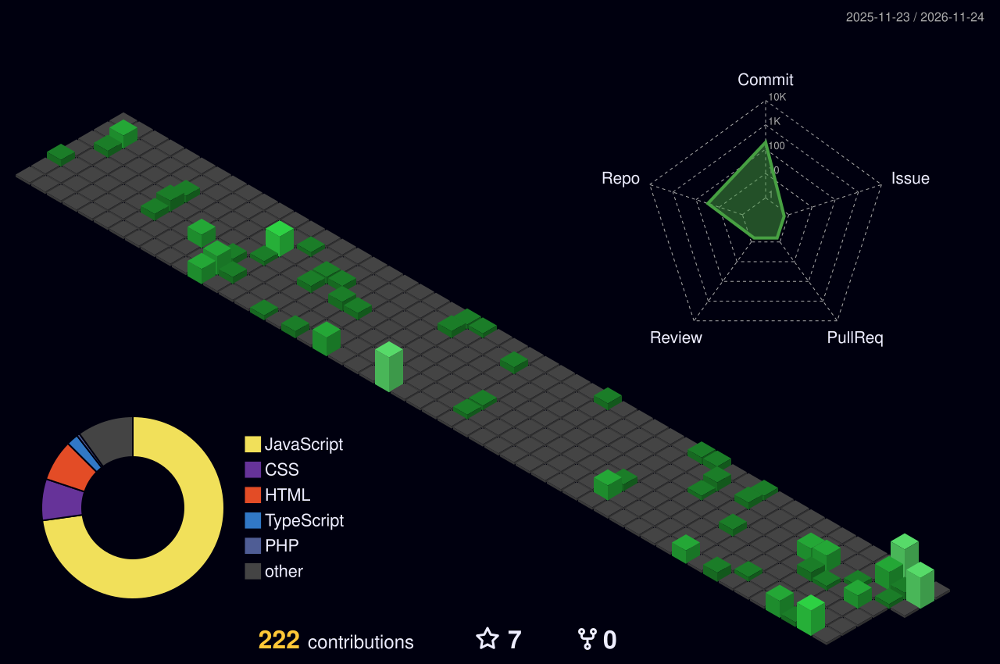
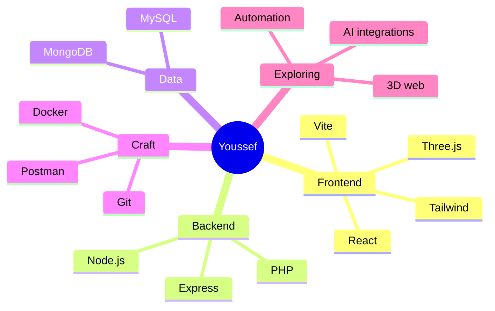

<!-- ═══════════════ HEADER ═══════════════ -->
<div align="center">


<a href="https://github.com/YoussefAbbasDev">
  
</a>

<br/>


<br/><br/>

<a href="https://youssef-abbas-portofolio.vercel.app"></a>
<a href="https://www.linkedin.com/in/youssef-mohamed-zabbas-092542299"></a>
<a href="mailto:youssefabbas722@gmail.com"></a>
<a href="https://instagram.com/y_abbas12"></a>
<a href="https://facebook.com/youssef.abbas.979095"></a>

</div>

<br/>

<!-- ═══════════════ 3D CONTRIBUTIONS ═══════════════ -->
<div align="center">



</div>

---

## `~/whoami`

```js
const youssef = {
  name: "Youssef Mohamed Abbas",
  role: "Full-Stack Developer",
  studying: "Software Engineering / IT",
  from: "Egypt 🇪🇬",
  focus: ["Scalable web apps", "APIs & architecture", "AI integrations", "3D on the web"],
  currentlyExploring: ["Software architecture", "AI-powered products", "Three.js worlds"],
  funFact: "I like building things that people can actually walk around in.",
  status: "Always shipping 🚀"
};
```

---

## `⚡ TOOLKIT`

<div align="center">

<br/>
<br/>
<br/>


</div>

<details>
<summary><b>🧠 Mind-map of how I think about the stack</b></summary>



</details>

---

## `📊 LIVE STATS`

<div align="center">


</div>

---

## `🏆 TROPHIES`

<div align="center">


</div>

---

## `📈 ACTIVITY GRAPH`

<div align="center">


</div>

---

## `🚀 FEATURED PROJECTS`

> Replace `REPO_NAME_1..4` with your real repo names (the ones you want people to see first).

<div align="center">

<a href="https://github.com/YoussefAbbasDev/REPO_NAME_1"></a>
<a href="https://github.com/YoussefAbbasDev/REPO_NAME_2"></a>
<a href="https://github.com/YoussefAbbasDev/REPO_NAME_3"></a>
<a href="https://github.com/YoussefAbbasDev/REPO_NAME_4"></a>

<br/>

<a href="https://github.com/YoussefAbbasDev?tab=repositories"></a>

</div>

---

## `🎯 CURRENT QUESTS`

| Quest | Progress |
|---|---|
| 🧱 Master software architecture & system design |  |
| 🤖 Build practical AI-powered apps |  |
| 🌐 Push the limits of 3D on the web (Three.js) |  |
| ⚙️ Automate everything that can be automated |  |

---

## `🐍 CONTRIBUTION SNAKE`

<div align="center">

<picture>
  <source media="(prefers-color-scheme: dark)" srcset="https://raw.githubusercontent.com/YoussefAbbasDev/YoussefAbbasDev/output/github-contribution-grid-snake-dark.svg" />
  
</picture>

</div>

---

## `📡 FIND ME`

<div align="center">

<a href="https://youssef-abbas-portofolio.vercel.app">🌐 Portfolio</a> &nbsp;·&nbsp;
<a href="https://www.linkedin.com/in/youssef-mohamed-zabbas-092542299">💼 LinkedIn</a> &nbsp;·&nbsp;
<a href="mailto:youssefabbas722@gmail.com">✉️ Email</a>

<br/><br/>


</div>
